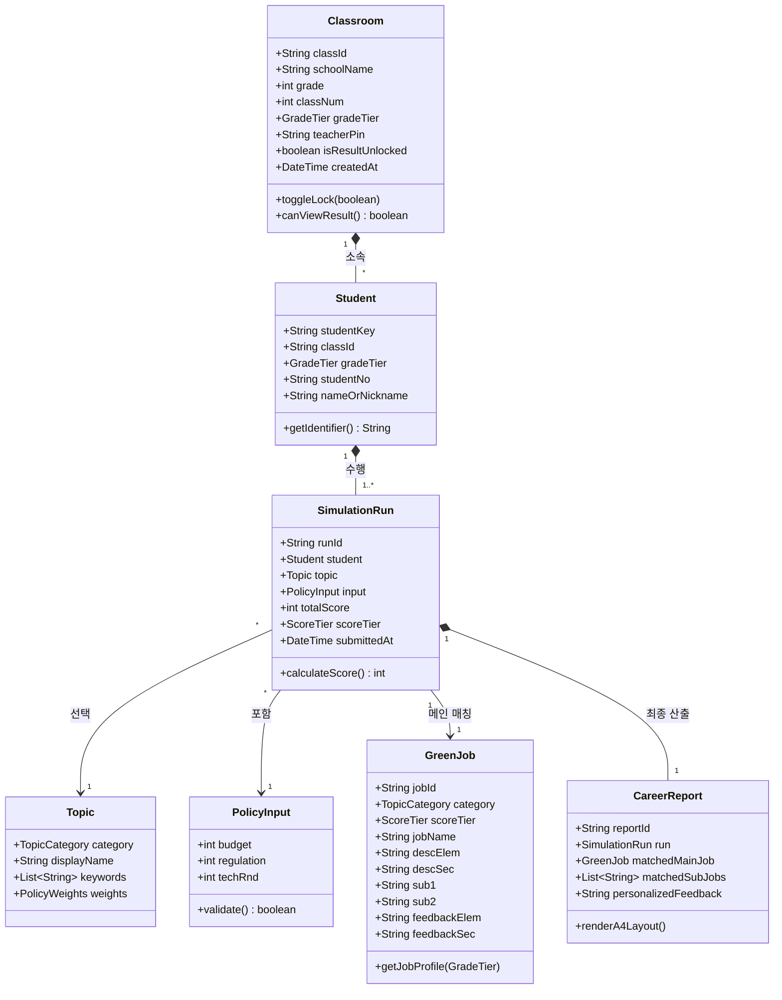
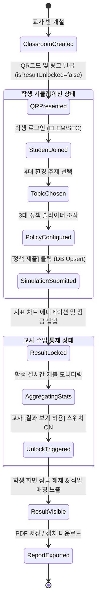

# 01. 그린잇! (Green-it!) 도메인 모델 정의서

본 문서는 **<그린잇! (Green-it!)>** 플랫폼의 핵심 비즈니스 로직, 데이터 엔티티, 상태 전이 규칙 및 평가/매칭 알고리즘을 정의한 **도메인 모델(Domain Model) 명세서**입니다.

---

## 1. 도메인 개요 및 설계 철학

* **목적:** 초·중·고 학생들의 환경 정책 시뮬레이션 경험을 정량화하고, 학생의 정책 성향에 최적화된 미래 환경 직업(Green Job)과 맞춤형 피드백을 도출하여 진로 교육 및 학교생활기록부(세특)로 연결.
* **학교급별 이원화 원칙:**
  * **초등부 (`ELEM`):** 친근한 닉네임 기반 참여, 스토리텔링 중심의 쉬운 직무 설명, '환경 지킴이' 격려 피드백.
  * **중·고등부 (`SEC`):** 학번+실명 기반 정규 참여, ESG·글로벌 규제·산업 기술 중심의 심화 직무 설명, 생기부 세특 작성용 정책 분석 피드백.
* **교육적 피드백 철학:**  
  시뮬레이션 점수가 낮더라도 '실패'로 규정하지 않고, 가장 시급한 위기 현장에 투입될 **'긴급 위기대응가 및 블루오션 개척가'**로 긍정 승화하여 재도전 의지를 고취.

---

## 2. 도메인 엔티티 다이어그램

---

## 3. 핵심 도메인 엔티티 및 속성 정의

### 3.1 학급 (Classroom)
교사가 개설하고 통제하는 단일 수업 세션 단위입니다.
* `classId` (String): 학급 고유 식별 코드 (예: `CLS_20261012_HANGUK_6_2`)
* `schoolName` (String): 학교명 (예: `한국초등학교`)
* `grade` (Integer): 학년 (1~6 또는 1~3)
* `classNum` (Integer): 반 (1~20)
* `gradeTier` (Enum): `ELEM` (초등) | `SEC` (중·고등)
* `teacherPin` (String): 교사용 관리 비밀번호 (4~6자리)
* `isResultUnlocked` (Boolean): 학생 개별 결과 조회 허용 여부 (기본값: `false`)
* `createdAt` (DateTime): 생성 일시

### 3.2 학생 / 참가자 (Student)
* `studentKey` (String): 학급 내 고유 식별 키 (중복 저장 방지용)
  * 초등: `[classId]_[nickname]` (예: `CLS_HANGUK_6_2_초록별`)
  * 중·고등: `[classId]_[studentNo]` (예: `CLS_SEOUL_HIGH_2_3_20315`)
* `gradeTier` (Enum): 학교급 구분
* `studentNo` (String): 번호 또는 학번
* `nameOrNickname` (String): 학생 닉네임(초등) 또는 실명(중고등)

### 3.3 환경 주제 (Topic)
학생이 해결하고자 선택하는 4대 핵심 환경 분야입니다.
1. **산림생태 (`FOREST`):** 산림 탄소 흡수원 확충, 도심 녹지 네트워크, 생태축 및 야생동물 서식지 복원
2. **해양생태 (`OCEAN`):** 해양 보호구역(MPA) 지정, 고수온·백화현상 대응, 지속가능한 어업 및 블루카본
3. **기후에너지 (`ENERGY`):** 온실가스 감축, 신재생에너지(태양광·풍력·수소) 전환, 스마트 마이크로그리드
4. **자원순환 (`RECYCLE`):** 순환경제 모델 구축, 폐기물 업사이클링, 플라스틱 대체 생분해 신소재 개발

### 3.4 정책 파라미터 (PolicyInput)
학생이 3단계 슬라이더를 통해 결정하는 정책 수치 (0 ~ 100 범위):
* `budget` ($P_B$): 공공 예산 투입량
* `regulation` ($P_R$): 법적 규제 강도 및 탄소세율
* `techRnd` ($P_T$): 친환경 미래 기술 R&D 투자 비중

### 3.5 점수 구간 티어 (ScoreTier)
* **상위 구간 (`HIGH`, 80~100점):** 미래 전략가 및 거시 시스템 설계자
* **중위 구간 (`MID`, 50~79점):** 현장 실천가 및 브릿지 중재 전문가
* **하위 구간 (`LOW`, 0~49점):** 긴급 위기대응가 및 블루오션 개척가

---

## 4. 점수 산출 및 직업 매칭 알고리즘 명세

### 4.1 정책 시뮬레이션 점수 공식 ($Score$)
단순 평균이 아닌, 주제별 핵심 가중치와 극단적 정책 편중을 방지하는 **밸런스 팩터($B$)**를 적용합니다.

$$Score = \text{Round}\left(\min\left(100, \max\left(0, (w_B P_B + w_R P_R + w_T P_T) \times B \right)\right)\right)$$

#### (1) 분야별 가중치 테이블 ($w_B, w_R, w_T$)
| 환경 주제 | 예산($w_B$) | 규제($w_R$) | 기술($w_T$) | 설계 의도 |
| :--- | :---: | :---: | :---: | :--- |
| **산림생태** | 0.35 | 0.35 | 0.30 | 토지 매입·조림 예산과 개발 제한 규제의 균형 |
| **해양생태** | 0.30 | 0.45 | 0.25 | 어획량 제한 및 해양보호구역 법적 규제의 강력한 비중 |
| **기후에너지** | 0.30 | 0.30 | 0.40 | 신재생·그리드 혁신 기술 개발의 비중 극대화 |
| **자원순환** | 0.25 | 0.40 | 0.35 | 일회용품 금지 등 사회적 규제와 대체소재 R&D 결합 |

#### (2) 밸런스 팩터 ($B$)
어느 하나의 정책만 100이고 나머지가 0인 극단적 편중 정책은 비효율적 행정으로 간주하여 감점을 적용합니다:
* 표준편차 $\sigma \le 20$: 균형 잡힌 정책 $\rightarrow B = 1.05$ (5% 가산)
* 표준편차 $20 < \sigma \le 40$: 일반적 분포 $\rightarrow B = 1.00$
* 표준편차 $\sigma > 40$: 극단적 편중 $\rightarrow B = 0.90$ (10% 감점)

### 4.2 직업 매칭 결정 규칙 (Decision Matrix)
1. 사용자가 선택한 **`category`**로 직업군 1차 필터링
2. 산출된 **`totalScore`**가 포함되는 점수 구간(`score_min` $\le Score \le$ `score_max`)으로 2차 필터링
3. 조건에 맞는 **메인 직업 1종**과 **연관 서브 직업 2종** 확정
4. 학생의 `gradeTier`에 따라:
   * `ELEM`: `desc_elem`, `feedback_elem` 전달
   * `SEC`: `desc_sec`, `feedback_sec` 전달

---

## 5. 도메인 라이프사이클 및 상태 전이도

