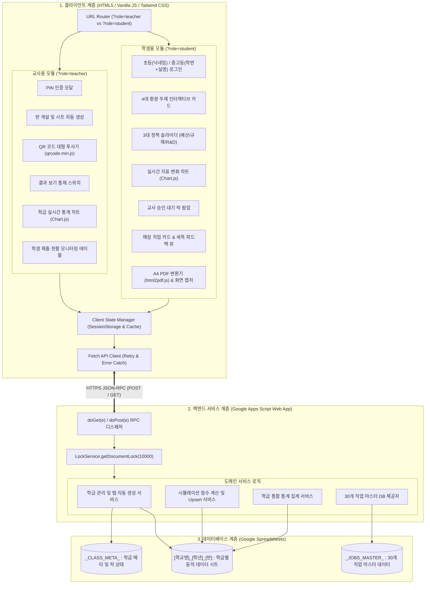
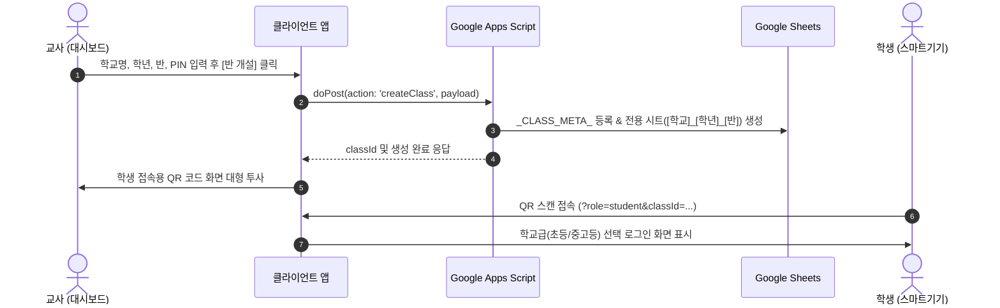
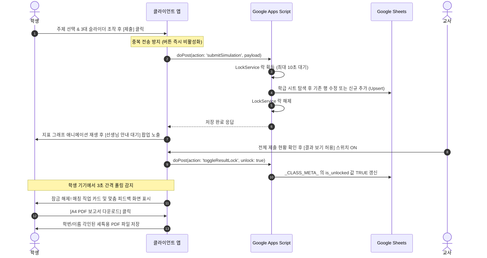

# 02. 그린잇! (Green-it!) 시스템 아키텍처 설계서

본 문서는 **<그린잇! (Green-it!)>** 플랫폼의 전체 소프트웨어 구조, 계층별 컴포넌트, 데이터 흐름, 동시성 제어 및 인프라 최적화 전략을 규정한 **시스템 아키텍처 설계서**입니다.

---

## 1. 아키텍처 설계 목표 및 제약 조건

1. **무비용 서버리스 (Zero-Cost Serverless):**  
   별도의 AWS/GCP 등 유료 서버 없이 Google 계정의 Google Apps Script(GAS)와 Google Sheets만으로 운영.
2. **학교 네트워크 환경 최적화 (Resilient & Lightweight):**  
   교실 내 불안정한 Wi-Fi 및 대역폭 제약을 감안하여 정적 리소스 최소화, 클라이언트 메모리 캐싱, 비동기 디바운스 적용.
3. **학급 단위 동시성 충돌 방지 (Concurrency Safe):**  
   수업 중 30~40명의 학생이 일제히 [제출] 버튼을 눌러도 구글 시트 쓰기 락 충돌 및 데이터 유실을 100% 방어.
4. **선생님의 수업 통제권 완벽 보장 (Pedagogical State Sync):**  
   학생이 개인 기기로 임의 진행하지 못하도록 교사 대시보드의 상태 변경에 따라 학생 기기의 화면 접근을 통제.

---

## 2. 전체 시스템 계층 구조 (Layered Architecture)



---

## 3. 핵심 데이터 흐름 및 시퀀스 다이어그램

### 3.1 반 개설 및 학생 접속 흐름


### 3.2 정책 시뮬레이션 및 교사 통제 잠금 흐름


---

## 4. 고가용성 및 동시성 제어 전략

### 4.1 GAS LockService를 통한 동시성 큐잉
학교 수업 특성상 "자, 지금 제출하세요!"라는 교사의 말 한마디에 30명 이상의 학생이 1~2초 사이에 일제히 요청을 전송합니다.
* **문제:** 스프레드시트는 다중 쓰기 요청 시 행 번호 충돌(Overwriting)이나 파일 잠금 에러가 발생하기 쉽습니다.
* **해결책:** 백엔드 쓰기 진입점에 `LockService.getDocumentLock()`을 적용합니다.
  ```javascript
  const lock = LockService.getDocumentLock();
  try {
    // 최대 10초간 대기하며 순차적으로 트랜잭션 획득
    lock.waitLock(10000); 
    
    // 안전한 시트 탐색 및 Upsert 실행
    executeUpsert(sheet, studentData);
  } finally {
    lock.releaseLock();
  }
  ```

### 4.2 멱등성 보장 (Upsert 로직)
학생이 실수로 슬라이더를 잘못 건드려 재제출하거나 네트워크 재시도가 발생해도 행이 무한히 늘어나지 않도록 **학생 식별 키(`studentKey`)**를 기준으로 업데이트합니다.
1. 학급 시트의 `student_key` 컬럼(B열)을 스캔
2. 동일 키가 존재할 경우: 해당 행(Row)의 기존 데이터를 최신 수치로 덮어쓰기 (`UPDATE`)
3. 존재하지 않을 경우: 시트 최하단에 신규 행 추가 (`INSERT`)

### 4.3 트래픽 및 쿼터 최적화 (브라우저 메모리 캐싱)
* 30개의 미래 그린잡 마스터 데이터(`_JOBS_MASTER_`)는 앱 최초 진입 시 1회만 호출하여 `window.GREEN_IT_JOBS` 메모리에 캐싱합니다.
* 직업 매칭 및 점수 계산 로직은 클라이언트 엔진에서 즉각 수행하여 불필요한 서버 호출 왕복 지연시간(RTT)을 없앱니다.

---

## 5. 학교 현장 예외 상황 대비 (Resilience)

| 시나리오 | 발생 원인 | 대응 아키텍처 및 복구 대책 |
| :--- | :--- | :--- |
| **Wi-Fi 지연/단절** | 학교 무선 AP 트래픽 폭증 | 제출 실패 시 자동 재시도 큐(Retry 3회) 및 로컬스토리지 임시 보관 |
| **PDF 렌더링 오류** | 저사양 태블릿 메모리 부족 | html2pdf 외에 HTML5 Canvas 기반의 **[화면 캡처 즉시 저장]** 비상 버튼 제공 |
| **교사 PIN 분실** | 수업 중 비밀번호 망각 | 기본 마스터 리셋 PIN 설정 및 반 개설 완료 시 브라우저 세션 자동 인증 유지 |
| **GAS 일일 할당량 초과** | 읽기/쓰기 횟수 과다 | 직업 마스터 데이터 클라이언트 캐싱 및 통계 조회 주기 디바운스(3초 폴링) |
