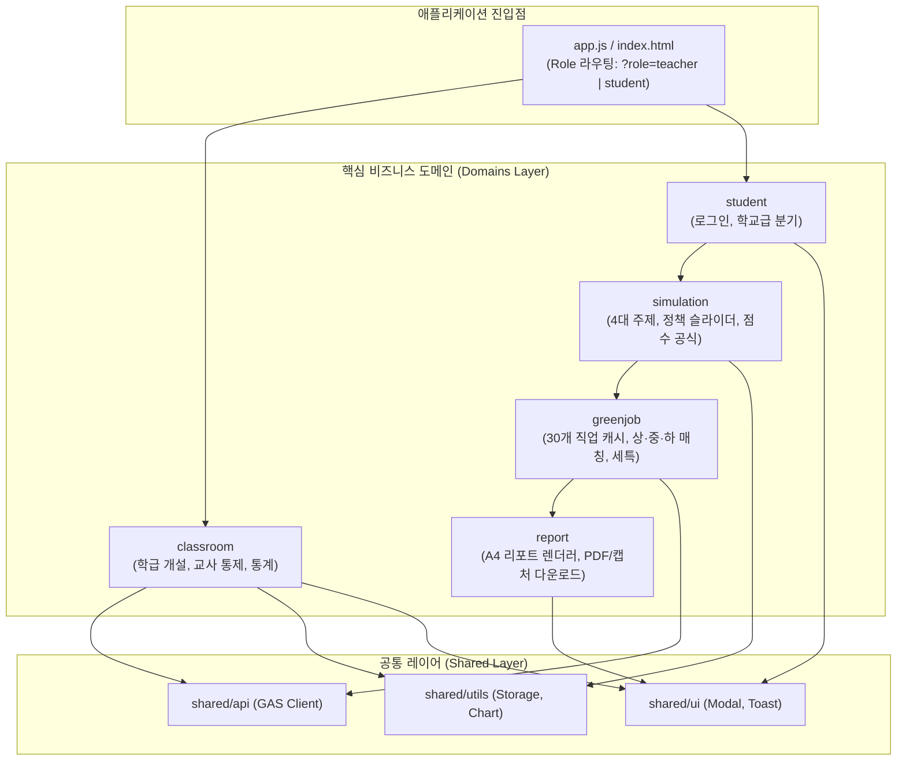
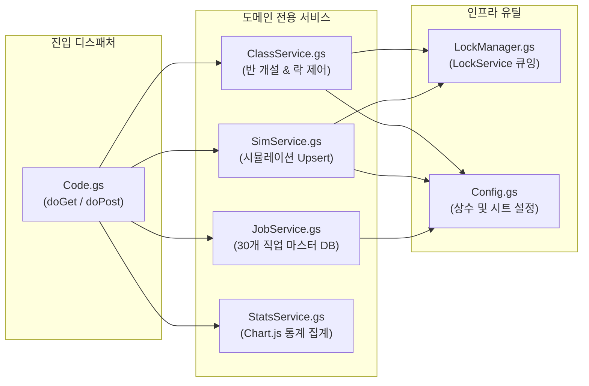

# 05. 그린잇! (Green-it!) 도메인 주도 폴더 아키텍처 설계서

본 문서는 **<그린잇! (Green-it!)>** 플랫폼을 기능 중심(Feature/Domain-Driven)으로 모듈화하여, 향후 기능 확장 및 유지보수(새로운 직업 추가, 정책 공식 변경, 학교급 추가 등) 시 특정 폴더만 직관적으로 수정할 수 있도록 설계한 **도메인 중심 폴더 구조 및 모듈 관계도**입니다.

---

## 1. 전체 디렉토리 트리 구조 (Domain-Driven Tree)

```text
261012 티처랩/
├── docs/                                   # 📚 프로젝트 설계 및 운영 명세서
│   ├── 00_마스터_기획서.md                   # 비즈니스 목표 및 현장 운영 타임라인
│   ├── 01_도메인_모델_정의서.md              # 핵심 엔티티, 상태 머신, 평가 공식
│   ├── 02_시스템_아키텍처_설계서.md          # 인프라, 동시성(LockService), 시퀀스
│   ├── 03_데이터베이스_스키마_명세서.md      # 시트 스키마 & 30개 직업 풀 전문
│   ├── 04_API_인터페이스_명세서.md           # GAS Web App doGet/doPost RPC 규격
│   └── 05_도메인_폴더_아키텍처_설계서.md     # 본 문서 (모듈 및 관계도)
│
├── src/                                    # 💻 프론트엔드 소스코드 (도메인 단위 모듈)
│   │
│   ├── domains/                            # 🎯 핵심 비즈니스 도메인
│   │   ├── classroom/                      # 🏫 [도메인 1] 학급 관리 & 수업 통제 (교사용)
│   │   │   ├── classroom.state.js          # 학급 상태 (PIN, 잠금여부, 통계 데이터)
│   │   │   ├── classroom.service.js        # 반 개설, 잠금 토글 API 통신
│   │   │   └── components/
│   │   │       ├── ClassCreatorModal.js    # 반 개설 모달 UI
│   │   │       ├── QrProjector.js          # 대형 화면 접속 QR 투사기
│   │   │       ├── TeacherLockSwitch.js    # [결과 보기 허용] 통제 토글 버튼
│   │   │       ├── ClassStatsChart.js      # 반 전체 선호 주제/직업 Chart.js
│   │   │       └── StudentMonitorTable.js  # 학생 제출 실시간 모니터링 테이블
│   │   │
│   │   ├── student/                        # 🎒 [도메인 2] 학생 인증 & 프로필
│   │   │   ├── student.model.js            # 학생 모델 (초등: 닉네임 / 중고등: 학번+실명)
│   │   │   └── components/
│   │   │       ├── GradeSelector.js        # [초등] vs [중·고등] 학교급 선택 카드
│   │   │       └── StudentLoginForm.js     # 학교급별 맞춤형 로그인 폼
│   │   │
│   │   ├── simulation/                     # 🌿 [도메인 3] 환경 정책 시뮬레이터
│   │   │   ├── simulation.engine.js        # 정책 가중치 및 점수(0~100) 산출 공식
│   │   │   ├── topics.data.js              # 4대 환경 주제(산림, 해양, 에너지, 순환) 메타데이터
│   │   │   └── components/
│   │   │       ├── TopicCardPicker.js      # 4대 주제 선택 카드 UI
│   │   │       ├── PolicySliders.js        # 예산/규제/R&D 3대 정책 슬라이더
│   │   │       └── MetricLiveChart.js      # 정책 조작 시 차오르는 지표 애니메이션
│   │   │
│   │   ├── greenjob/                       # 💼 [도메인 4] 직업 매칭 & 피드백
│   │   │   ├── greenjob.matcher.js         # 주제 × 점수구간(상/중/하) 매칭 엔진
│   │   │   ├── greenjob.cache.js           # 30개 직업 마스터 데이터 메모리 캐시
│   │   │   └── components/
│   │   │       ├── WaitingLockModal.js     # "선생님의 안내를 기다려주세요" 대기 팝업
│   │   │       ├── MatchedJobCard.js       # 매칭된 메인 1개 + 서브 2개 직업 카드
│   │   │       └── TailoredFeedback.js     # 초등 칭찬 vs 고등 세특 맞춤 피드백
│   │   │
│   │   └── report/                         # 📄 [도메인 5] 진로 리포트 및 출력
│   │       ├── report.template.js          # A4 공식 보고서 인쇄용 HTML 레이아웃
│   │       ├── pdf.exporter.js             # html2pdf.js 기반 PDF 다운로드 모듈
│   │       └── capture.exporter.js         # html2canvas 기반 비상용 화면 캡처 모듈
│   │
│   ├── shared/                             # 🛠 공통 인프라 및 유틸리티 레이어
│   │   ├── api/
│   │   │   ├── gas.client.js               # GAS 전용 Fetch 어댑터 (재시도/에러 핸들링)
│   │   │   └── endpoints.js                # API Action 상수 정의
│   │   ├── ui/
│   │   │   ├── Modal.js                    # 범용 모달 래퍼
│   │   │   ├── Toast.js                    # 안내 알림 토스트
│   │   │   └── LoadingSpinner.js           # 로딩 인디케이터
│   │   └── utils/
│   │       ├── storage.js                  # SessionStorage 안전 읽기/쓰기
│   │       └── chart.helper.js             # Chart.js 기본 테마/옵션 프리셋
│   │
│   ├── app.js                              # 🚀 라우팅(?role=teacher|student) 및 메인 초기화
│   └── styles/
│       └── main.css                        # 디자인 시스템 컬러, 글래스모피즘, 반응형 스타일
│
├── backend/                                # ☁️ 백엔드 소스코드 (Google Apps Script)
│   ├── Code.gs                             # 진입점 (doGet / doPost 요청 디스패처)
│   ├── Config.gs                           # 스프레드시트 ID, 시트 이름, 에러 코드 상수
│   ├── LockManager.gs                      # LockService(10초) 동시성 큐잉 헬퍼
│   ├── ClassService.gs                     # 반 개설, 시트 탭 자동 생성, 락 토글
│   ├── SimService.gs                       # 시뮬레이션 결과 Upsert(수정/추가) 저장
│   ├── JobService.gs                       # 30개 직업 마스터 DB 제공 및 초기 시트 시딩
│   └── StatsService.gs                     # 학급별 통계 집계 및 요약 JSON 생성
│
└── index.html                              # 🌐 무설치 단일 웹 앱 배포 번들 (프론트엔드 진입점)
```

---

## 2. 도메인 간 관계도 (Domain Dependency Diagram)

도메인 주도 설계(DDD)의 단방향 의존성 원칙을 준수하여, 상위 도메인의 변경이 다른 도메인으로 전파되지 않도록 설계되었습니다.



---

## 3. 도메인별 세부 책임 및 유지보수 분리점

| 폴더 위치 | 담당 도메인 | 핵심 책임 및 캡슐화 내용 | 유지보수 발생 시 작업 포인트 |
| :--- | :--- | :--- | :--- |
| **`domains/classroom/`** | **학급 & 수업 통제** | • 교사용 인증(PIN)<br>• 반 개설 및 구글 시트 탭 생성 요청<br>• 학생 접속용 QR 코드 렌더링<br>• [결과 허용] 스위치 상태 변경<br>• 반 전체 제출 통계 시각화 | • 교사 비밀번호 정책 변경<br>• QR 화면 투사 레이아웃 조정<br>• 교사용 통계 차트 지표 추가 |
| **`domains/student/`** | **학생 인증 & 프로필** | • [초등] vs [중·고등] 학교급 선택<br>• 닉네임 또는 학번/실명 유효성 검사<br>• 브라우저 세션 스토리지 식별 키 보관 | • 로그인 입력 항목 변경<br>• 학교급(초등/중등/고등) 3단계 세분화 |
| **`domains/simulation/`** | **환경 정책 시뮬레이션** | • 4대 환경 주제(산림/해양/에너지/순환) 정의<br>• 3대 정책 슬라이더 인터랙션<br>• 주제별 가중치($w_1, w_2, w_3$) 및 밸런스 공식 적용 점수(0~100) 산출 | • 새로운 환경 주제 추가 (예: 우주환경)<br>• 정책 슬라이더 개수 변경<br>• 점수 산출 공식 및 가중치 튜닝 |
| **`domains/greenjob/`** | **직업 매칭 & 피드백** | • 30개 미래 그린잡 데이터 캐싱<br>• 점수 티어(상·중·하) 기반 메인 1개 + 서브 2개 매칭<br>• 교사 잠금 시 "대기 팝업" 유지 및 3초 폴링<br>• 초등 스토리텔링 vs 고등 생기부 세특 피드백 분기 | • 직업 명칭이나 추천 직업군 수정<br>• 생기부 세특 맞춤형 문구 개편<br>• 점수 등급 컷오프(현재 80/50점) 조정 |
| **`domains/report/`** | **진로 리포트 및 출력** | • 학생 정보 및 시뮬레이션 결과가 각인된 A4 규격 레이아웃 빌드<br>• `html2pdf.js` 통한 공식 PDF 저장<br>• 비상용 HTML5 Canvas 화면 캡처 저장 | • PDF 보고서 인쇄 양식(레이아웃/로고) 변경<br>• 수행평가 제출용 서명란/체크리스트 추가 |
| **`shared/`** | **공통 인프라** | • 백엔드(GAS) 통신 재시도(Retry) 및 에러 처리<br>• 범용 모달, 토스트, 스피너 UI<br>• Chart.js 스타일 헬퍼 | • GAS 배포 URL 변경<br>• 전역 UI 테마/컬러 팔레트 변경 |
| **`backend/`** | **서버리스 백엔드 (GAS)** | • 구글 시트 다중 탭 제어<br>• LockService 동시성 큐잉<br>• 동일 학생 재제출 시 Upsert 덮어쓰기<br>• 집계 데이터 JSON 직렬화 | • 구글 시트 컬럼 구조 확장<br>• 동시성 타임아웃 시간 조정 |

---

## 4. 백엔드(GAS) 도메인 서비스 매핑 구조

Google Apps Script는 단일 파일로 뭉쳐지기 쉽기 때문에, 아래와 같이 스크립트 파일을 기능별로 완전히 분리하여 관리합니다.



---

## 5. 결론 및 유지보수 시나리오 예시

* **시나리오 A: "고등학생 생기부 피드백 문구를 수정하고 싶어요."**  
  $\rightarrow$ 다른 코드는 볼 필요 없이 `src/domains/greenjob/components/TailoredFeedback.js` 또는 `03_데이터베이스_스키마_명세서.md`의 고등용 피드백 텍스트만 수정하면 됩니다.
* **시나리오 B: "환경 주제에 '우주항공 환경'을 추가하고 싶어요."**  
  $\rightarrow$ `src/domains/simulation/topics.data.js`에 주제를 정의하고, `domains/greenjob/`에 매칭 직업 3개를 추가 등록하면 자동으로 UI와 로직이 연동됩니다.
* **시나리오 C: "PDF 다운로드가 학교 기기에서 깨져요."**  
  $\rightarrow$ 비즈니스 로직과 완전 분리된 `src/domains/report/pdf.exporter.js` 렌더러 모듈만 디버깅하면 됩니다.
