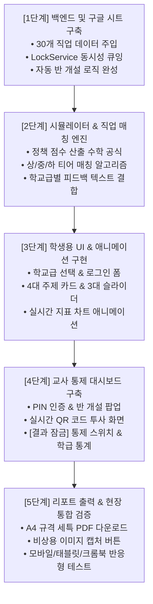

# 06. 그린잇! (Green-it!) 구체적 개발 계획서 (비개발자 친화형 가이드)

본 문서는 **<그린잇! (Green-it!)>** 개발에 착수하기 전, **어떤 파일들을 생성할 것이며 각 파일이 무슨 역할을 하는지**, 그리고 **어떤 순서로 작업을 진행할지**를 비개발자 선생님도 한눈에 이해할 수 있도록 쉽게 풀어쓴 **단계별 개발 계획서**입니다.

---

## 1. 비유로 이해하는 그린잇! 시스템 구조

우리 앱을 학교에서 열리는 **"미래 환경 진로 축제"**로 비유하면 이해가 아주 쉽습니다.

```
┌─────────────────────────────────────────────────────────────────┐
│                    🏫 [그린잇! 환경 진로 축제]                    │
├─────────────────┬───────────────────────────────┬───────────────┤
│ 1. 교사용 방송실  │ 2. 학생용 체험 부스             │ 3. 축제 본부  │
│ (Classroom)     │ (Student + Simulation + Job)  │ (Backend)     │
│                 │                               │               │
│ • 선생님 통제실 │ • 명찰 발급 (초등/고등)       │ • 비밀 장부   │
│ • 대형 QR 띄우기│ • 정책 슬라이더 조작 체험     │   (구글시트)  │
│ • 결과 잠금/해제│ • AI 그린잡 매칭              │ • 안전 요원   │
│ • 우리 반 통계  │ • A4 세특 보고서 인쇄         │   (동시성 제어)│
└─────────────────┴───────────────────────────────┴───────────────┘
```

* **백엔드 (`backend/`):** 축제 본부의 비밀 장부와 안전 요원입니다. 학생들이 낸 결과를 구글 시트에 차곡차곡 적고, 30명이 동시에 제출해도 장부가 엉키지 않게 교통정리를 합니다.
* **학급 도메인 (`classroom/`):** 축제 총괄 선생님의 방송실입니다. QR코드를 스크린에 띄우고, "아직 결과 보지 마세요!" 하고 잠금 스위치를 켭니다.
* **학생 도메인 (`student/`):** 명찰 발급 창구입니다. 초등학생은 귀여운 닉네임으로, 고등학생은 학번과 실명으로 명찰을 달아줍니다.
* **시뮬레이션 도메인 (`simulation/`):** 환경 정책 조작 부스입니다. 예산, 규제, 기술 슬라이더를 올리고 내리면 게이지가 오르내립니다.
* **그린잡 도메인 (`greenjob/`):** 미래 진로 진단실입니다. 0~100점 점수에 맞춰 30개 직업 중 가장 어울리는 직업 3개를 짝지어 줍니다.
* **보고서 도메인 (`report/`):** 축제 수료증 인쇄소입니다. 학번과 이름이 찍힌 A4 PDF 보고서를 즉석에서 출력해 줍니다.

---

## 2. 폴더별 생성 파일 목록 및 역할 정의

앞으로 실제로 생성할 파일들과 각 파일이 하는 일입니다.

### ① 백엔드 폴더 (`backend/`) — "구글 시트 연동 및 서버"
| 파일명 | 비개발자를 위한 쉬운 설명 |
| :--- | :--- |
| **`Config.gs`** | **"기본 설정 파일"** — 구글 스프레드시트 주소, 비밀번호 규칙, 탭 이름을 모아둔 곳입니다. |
| **`LockManager.gs`** | **"교통정리 요원"** — 30명이 동시에 [제출]을 눌러도 구글 시트가 멈추지 않게 한 줄로 줄을 세워줍니다. |
| **`JobService.gs`** | **"직업 백과사전"** — 30개 직업의 초등용/고등용 설명문을 구글 시트에 자동으로 채워 넣는 역할을 합니다. |
| **`ClassService.gs`** | **"새 학급 도우미"** — 교사가 '반 개설'을 누르면 구글 시트에 `한국초_6_2` 탭을 자동으로 뚝딱 만들어줍니다. |
| **`SimService.gs`** | **"성적표 기록원"** — 학생이 제출한 점수와 선택한 정책을 학급 시트에 기록하고, 다시 제출하면 기존 줄을 수정해 줍니다. |
| **`StatsService.gs`** | **"통계 계산기"** — 우리 반에서 어떤 주제가 인기 있는지, 평균 점수가 몇 점인지 계산해서 교사 화면에 보냅니다. |
| **`Code.gs`** | **"총괄 지휘자"** — 인터넷에서 들어오는 모든 요청(선생님의 반 개설, 학생의 제출 등)을 받아서 알맞은 서비스로 보냅니다. |

---

### ② 프론트엔드 도메인 폴더 (`src/domains/`) — "화면과 기능"

#### [1] `src/domains/classroom/` (교사용 학급 통제)
* **`classroom.state.js`**: 현재 개설된 반 이름, 학생 수, 결과 잠금 상태를 기억하는 메모장입니다.
* **`ClassCreatorModal.js`**: "학교명, 학년, 반, 비밀번호"를 입력받는 팝업창 화면입니다.
* **`QrProjector.js`**: 칠판/빔프로젝터에 큼직하게 띄울 학생 접속용 QR코드 화면입니다.
* **`TeacherLockSwitch.js`**: 선생님이 껐다 켤 수 있는 **[학생 결과 보기 허용]** 스위치 버튼입니다.
* **`ClassStatsChart.js`**: 반 아이들의 선택을 예쁜 원형/막대그래프로 보여주는 화면입니다.
* **`StudentMonitorTable.js`**: 누가 제출했고 누가 안 냈는지 한눈에 보는 실시간 출석부 형태의 표입니다.

#### [2] `src/domains/student/` (학생 명찰 발급)
* **`GradeSelector.js`**: "나는 초등학생이에요 / 중·고등학생이에요"를 고르는 귀여운 카드 화면입니다.
* **`StudentLoginForm.js`**: 초등학생에게는 닉네임을, 고등학생에게는 학번+이름을 입력받는 로그인 창입니다.

#### [3] `src/domains/simulation/` (환경 정책 실험실)
* **`topics.data.js`**: 산림생태, 해양생태, 기후에너지, 자원순환 4가지 주제의 설명과 아이콘 모음집입니다.
* **`TopicCardPicker.js`**: 학생들이 4개 주제 중 하나를 터치해서 고르는 카드 화면입니다.
* **`PolicySliders.js`**: 예산, 규제, 기술 연구 슬라이더 3개를 손가락으로 드래그해 조작하는 화면입니다.
* **`simulation.engine.js`**: 슬라이더 수치를 바탕으로 "최종 점수(0~100점)"를 계산해 내는 수학 공식 엔진입니다.
* **`MetricLiveChart.js`**: 슬라이더를 움직일 때마다 지표가 실시간으로 차오르는 인터랙티브 애니메이션 그래프입니다.

#### [4] `src/domains/greenjob/` (AI 직업 매칭 및 피드백)
* **`greenjob.matcher.js`**: 4대 주제와 학생 점수(상·중·하)를 보고 가장 딱 맞는 직업 1개 + 서브 직업 2개를 골라주는 인공지능 매칭기입니다.
* **`WaitingLockModal.js`**: 선생님이 스위치를 켜기 전까지 뜨는 **"선생님의 안내를 기다려주세요"** 안내 잠금 팝업입니다.
* **`MatchedJobCard.js`**: 내게 매칭된 미래 그린잡의 이름과 캐릭터/아이콘, 설명이 예쁘게 적힌 카드 화면입니다.
* **`TailoredFeedback.js`**: 초등학생에겐 따뜻한 칭찬을, 고등학생에겐 **생기부 세특에 그대로 쓸 수 있는 분석 문구**를 보여주는 화면입니다.

#### [5] `src/domains/report/` (리포트 인쇄소)
* **`report.template.js`**: 학교, 학번, 이름, 그래프, 직업 설명이 가지런히 배치된 A4 규격의 보고서 종이 디자인입니다.
* **`pdf.exporter.js`**: 버튼 한 번으로 위의 종이 디자인을 깔끔한 PDF 파일로 변환해 주는 도구입니다.
* **`capture.exporter.js`**: 학교 인터넷이 느려 PDF가 잘 안 될 때, 화면을 즉시 사진(PNG)으로 캡처해 주는 비상용 도구입니다.

---

### ③ 공통 및 진입점 (`src/shared/`, 최상위)
* **`src/shared/api/gas.client.js`**: 구글 시트와 대화하는 전령사(통신 모듈)입니다. 인터넷이 잠깐 끊겨도 3번 다시 시도합니다.
* **`src/styles/main.css`**: 초록색 계열의 세련되고 눈이 편안한 색상 팔레트와 버튼 디자인 스타일입니다.
* **`index.html`**: 모든 화면을 하나로 합쳐서 웹 브라우저에서 바로 열 수 있게 해주는 최종 파일입니다.

---

## 3. 구체적인 5단계 개발 로드맵 (Action Plan)

안전하고 완성도 높은 개발을 위해 다음 5단계 순서대로 진행합니다.



---

## 4. 작업 전 선생님께서 준비해 주실 사항 (단 1가지!)

* **Google 스프레드시트 1개 생성:**  
  선생님의 구글 드라이브에서 빈 스프레드시트를 하나 만들고 제목을 `그린잇_마스터_DB`로 지정해 두시면 됩니다.  
  (나머지 탭 생성, 30개 직업 데이터 입력, 코드 연결은 제가 제공해 드리는 코드가 자동으로 모두 처리합니다.)
