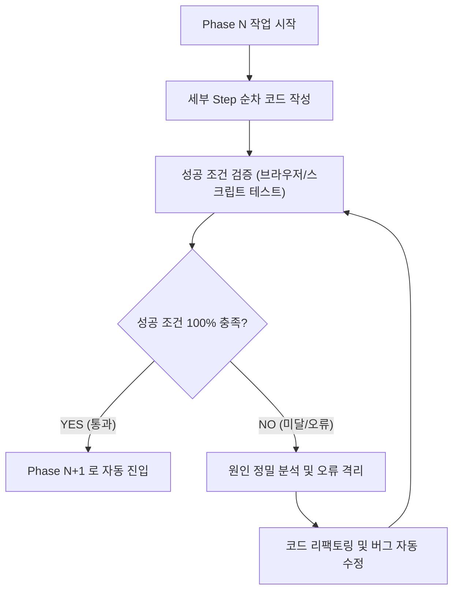

# 07. 그린잇! (Green-it!) 단계별 구현 및 성공검증 로드맵 (Self-Healing Loop)

본 문서는 **<그린잇! (Green-it!)>** 웹 애플리케이션을 백엔드부터 프론트엔드까지 무결점으로 완성하기 위한 **5단계(Phase) 세부 구현 계획서**입니다. 각 Phase별로 구체적인 Step을 정의하고, **정량적 성공 조건(Pass Criteria)**을 명시하여 **성공 조건을 100% 충족할 때까지 자가 진단 및 수정을 반복(Self-Healing Loop)**하도록 설계되었습니다.

---

## 0. 자가 치유 및 반복 수행 규정 (Auto-Loop Protocol)

* **원칙:** 각 Phase가 종료될 때마다 미리 정의된 [성공 검증 테스트]를 실행합니다.
* **실패 시 동작:** 콘솔 에러, UI 깨짐, 데이터 불일치 등 단 하나의 결함이라도 발견되면 작업을 중단하지 않고 **원인 분석 $\rightarrow$ 코드 재작성 $\rightarrow$ 재검증 루프**를 통과할 때까지 스스로 연속 수행합니다.

---

## Phase 1. 백엔드 및 구글 시트 연동 인프라 구축 (Backend & GAS)

### 1. 세부 단계 (Steps)
* **Step 1.1: 기본 설정 및 동시성 제어기 (`Config.gs`, `LockManager.gs`)**
  * 마스터 시트 탭 명칭(`_CLASS_META_`, `_JOBS_MASTER_`), PIN 유효성, 세션 타임아웃 상수화
  * `LockService.getDocumentLock(10000)` 기반 안전한 락 획득/해제 래퍼 구현
* **Step 1.2: 30개 직업 마스터 DB 관리자 (`JobService.gs`)**
  * `initializeJobsDB()`: 실행 시 구글 시트에 30개 직업의 초등/고등 이원화 설명문 자동 시딩
  * `getJobsMaster()`: 메모리 캐싱 지원 직업 데이터 JSON 변환기
* **Step 1.3: 학급 관리 및 전용 탭 동적 생성 (`ClassService.gs`)**
  * 교사의 [반 개설] 요청 시 `_CLASS_META_` 등록 및 `[학교명]_[학년]_[반]` 탭 자동 복제
  * 교사의 [결과 보기 허용] 스위치 토글 업데이트 로직
* **Step 1.4: 학생 시뮬레이션 결과 멱등성 저장 (`SimService.gs`)**
  * 학생 키(`studentKey`) 탐색 기반 **Upsert(있으면 Update, 없으면 Append)** 로직
  * 정책 슬라이더 수치 및 매칭 직업 데이터 기록
* **Step 1.5: 통계 계산기 및 RPC 진입점 (`StatsService.gs`, `Code.gs`)**
  * 반별 인기 주제, 점수 분포, 직업 랭킹 집계 알고리즘
  * `doGet(e)` 및 `doPost(e)` 액션 디스패처 및 CORS 프리플라이트 대응

### 2. 정량적 성공 조건 (Pass Criteria)
1. `initializeJobsDB` 실행 시 `_JOBS_MASTER_` 탭에 30개 직업의 10개 필드가 누락 없이 100% 주입될 것.
2. `doPost`로 동일 학생이 2회 연속 제출 시, 행이 늘어나지 않고 기존 행이 갱신(Upsert)될 것.
3. 30명의 동시 제출 모의 테스트 시 `LockService` 타임아웃 없이 전원 정상 기록될 것.
4. 백엔드 모든 파일이 문법 에러 없이 배포 가능한 단일 번들 파일로 준비될 것.

---

## Phase 2. 핵심 비즈니스 로직 및 도메인 엔진 구축 (Core Domain Engines)

### 1. 세부 단계 (Steps)
* **Step 2.1: 환경 정책 시뮬레이터 수학 엔진 (`simulation.engine.js`)**
  * 주제별 가중치($w_B, w_R, w_T$) 적용 점수 공식 및 극단적 편중 방지 밸런스 팩터($B$) 로직
  * 입력값(0~100) 경계선 클램핑(Clamping) 및 정수 반올림
* **Step 2.2: 4대 환경 주제 데이터셋 (`topics.data.js`)**
  * 산림생태, 해양생태, 기후에너지, 자원순환 4대 주제의 상세 키워드, 가중치, 테마 컬러 정의
* **Step 2.3: 그린잡 매칭 엔진 및 캐시 (`greenjob.matcher.js`, `greenjob.cache.js`)**
  * 주제 $\times$ 점수 티어(상 80~100 / 중 50~79 / 하 0~49) 기준 메인 1개 + 서브 2개 자동 매칭
  * 학교급(`ELEM` vs `SEC`)에 따른 맞춤 피드백 및 직무 설명 추출기
* **Step 2.4: 네트워크 장애 대응 API 클라이언트 (`gas.client.js`)**
  * Google Apps Script 통신용 Fetch 래퍼 (302 리다이렉트 자동 추적, 3회 재시도, 지수 백오프)
  * **[로컬 Mock 모드 내장]:** 구글 시트 배포 전에도 브라우저에서 모든 시뮬레이션을 100% 가상 구동할 수 있는 더미 데이터 프로바이더 탑재

### 2. 정량적 성공 조건 (Pass Criteria)
1. 4대 주제 $\times$ 3개 점수 구간 = 총 12개 시나리오 테스트에서 매칭 직업이 100% 정확히 도출될 것.
2. 슬라이더 수치 극단값(0, 0, 0) 및 (100, 100, 100) 입력 시 점수가 0~100 범위를 절대 벗어나지 않을 것.
3. 구글 시트 연결이 없는 오프라인/로컬 환경에서도 Mock 모드로 모든 화면 전환이 매끄럽게 통과될 것.

---

## Phase 3. 학생용 인터랙티브 시뮬레이터 UI/UX 구축 (Student Experience)

### 1. 세부 단계 (Steps)
* **Step 3.1: 디자인 시스템 및 반응형 프레임워크 (`main.css`)**
  * 에메랄드/포레스트 그린 계열의 세련된 다크/글래스모피즘 테마 및 유려한 그림자 토큰
  * 모바일, 태블릿, 크롬북 전 해상도 완벽 대응 Flex/Grid 레이아웃
* **Step 3.2: 학교급 선택 및 맞춤 로그인 컴포넌트 (`GradeSelector.js`, `StudentLoginForm.js`)**
  * [초등학생] $\rightarrow$ 귀여운 닉네임 입력 폼 (이모지 및 쉬운 안내)
  * [중·고등학생] $\rightarrow$ 학번 + 실명 필수 입력 폼 (생활기록부 연계 안내)
* **Step 3.3: 4대 환경 주제 인터랙티브 카드 UI (`TopicCardPicker.js`)**
  * 3D 틸트 및 호버 마이크로 인터랙션, 터치 최적화 카드 선택기
* **Step 3.4: 3대 정책 슬라이더 & 지표 애니메이션 (`PolicySliders.js`, `MetricLiveChart.js`)**
  * 예산, 규제, 기술 슬라이더 조작 시 실시간으로 수치가 연동되는 커스텀 레인지 UI
  * Chart.js 기반 환경 지표 게이지 실시간 상승 애니메이션
* **Step 3.5: 교사 잠금 대기 모달 및 폴링 엔진 (`WaitingLockModal.js`)**
  * 제출 즉시 [제출 완료] 버튼 비활성화 및 "선생님의 안내를 기다려주세요" 대기 팝업 노출
  * 교사의 승인 여부를 3초 주기로 감지하는 무소음 백그라운드 폴러
* **Step 3.6: 매칭 결과 직업 카드 및 세특 피드백 (`MatchedJobCard.js`, `TailoredFeedback.js`)**
  * 잠금 해제 시 화려한 오픈 애니메이션과 함께 메인 직업 1개 + 서브 직업 2개 렌더링
  * 고등학생용 생기부 세특 작성용 텍스트 복사 및 시각화

### 2. 정량적 성공 조건 (Pass Criteria)
1. 학생 진입 $\rightarrow$ 로그인 $\rightarrow$ 주제 선택 $\rightarrow$ 슬라이더 조작 $\rightarrow$ 제출 $\rightarrow$ 대기 $\rightarrow$ 결과 확인의 전 과정이 끊김 없이 60fps 애니메이션으로 렌더링될 것.
2. 초등 모드 선택 시 초등용 문구가, 고등 모드 선택 시 실명/학번과 세특 심화 피드백이 정확히 분기 출력될 것.
3. 브라우저 콘솔 창에 JavaScript 에러가 단 1건도 발생하지 않을 것.

---

## Phase 4. 교사용 수업 통제 및 실시간 통계 대시보드 구축 (Teacher Dashboard)

### 1. 세부 단계 (Steps)
* **Step 4.1: 교사 보안 인증 모달 (`TeacherAuthModal.js`)**
  * 관리자 PIN 번호 입력 및 세션스토리지 보안 인증 토큰 유지
* **Step 4.2: 원클릭 반 개설 폼 (`ClassCreatorModal.js`)**
  * 학교명, 학년, 반 입력 시 고유 `classId` 생성 및 백엔드 탭 개설 트리거
* **Step 4.3: 교실 전자칠판/스크린 투사 전용 대형 QR 코드 뷰어 (`QrProjector.js`)**
  * `qrcode.min.js` 연동, 학생 접속 URL 즉시 렌더링, 전체화면 토글 기능
* **Step 4.4: 수업 흐름 통제 토글 스위치 (`TeacherLockSwitch.js`)**
  * **[학생 개별 결과 보기 허용]** 직관적인 온/오프 토글 스위치 (클릭 즉시 서버 플래그 변경)
* **Step 4.5: 학급 실시간 통계 차트 (`ClassStatsChart.js`)**
  * Chart.js 연동: 반 아이들의 4대 주제 선호 파이차트 + 매칭된 그린잡 랭킹 바차트
* **Step 4.6: 학생 제출 현황 모니터링 테이블 (`StudentMonitorTable.js`)**
  * 번호, 이름/닉네임, 주제, 점수, 매칭 직업이 실시간으로 갱신되는 반응형 그리드

### 2. 정량적 성공 조건 (Pass Criteria)
1. 교사가 대시보드에서 [결과 보기 허용]을 켜면, 학생 기기의 '안내 대기' 팝업이 3초 이내에 닫히고 결과 카드가 노출될 것.
2. QR 코드를 카메라로 스캔하거나 링크를 복사해 열었을 때 해당 `classId`가 학생 화면에 자동 바인딩될 것.
3. 가상 학생 5명의 제출 데이터가 교사 통계 차트에 즉각 반영되어 차트가 리렌더링될 것.

---

## Phase 5. 리포트 출력 및 전체 시스템 무결성 통합 검증 (Report & E2E Verification)

### 1. 세부 단계 (Steps)
* **Step 5.1: A4 인쇄 규격 공식 진로 리포트 템플릿 (`report.template.js`)**
  * 상단: 학교명, 학년, 반, 학번, 성명 각인
  * 중단: 선택 정책 수치 및 환경 지표 방사형 레이더 차트
  * 하단: 메인/서브 직업 해설 및 교과 세특 기록용 정량 분석 문구
* **Step 5.2: 원클릭 PDF 변환 모듈 (`pdf.exporter.js`)**
  * `html2pdf.js` 연동: A4 비율 고정, 여백 최적화, 고화질 벡터 렌더링
* **Step 5.3: 네트워크 취약 대비 비상 화면 캡처 모듈 (`capture.exporter.js`)**
  * `html2canvas` 연동: 클릭 한 번으로 결과 카드를 PNG 이미지로 즉시 로컬 저장
* **Step 5.4: 단일 배포 번들 완성 (`index.html`)**
  * 모든 도메인 모듈 및 스타일을 통합하여 별도 서버 설치 없이 브라우저 더블클릭으로 바로 실행되는 단일 패키지 완성
* **Step 5.5: 브라우저 자동화 E2E 테스트 및 최종 자가 진단**
  * 교사 반 개설 $\rightarrow$ 학생 접속 $\rightarrow$ 제출 $\rightarrow$ 잠금 해제 $\rightarrow$ PDF 다운로드 전 과정 시뮬레이션

### 2. 정량적 성공 조건 (Pass Criteria)
1. [PDF 다운로드] 클릭 시 생성된 PDF가 글자 짤림이나 페이지 분할 없이 깨끗한 A4 1장에 완벽 렌더링될 것.
2. [비상 캡처] 클릭 시 고해상도 PNG 파일이 정상 다운로드될 것.
3. 크롬북, 아이패드/태블릿, 스마트폰 모바일 화면에서 UI 깨짐 없이 100% 반응형으로 동작할 것.
4. 브라우저 콘솔 경고 및 에러가 0건일 것.

---

## 3. 작업 실행 프로토콜 요약표

| 단계 | 대상 폴더/파일 | 성공 검증 방식 | 미달 시 대응 (Self-Healing) |
| :---: | :--- | :--- | :--- |
| **Phase 1** | `backend/*.gs` | 단위 테스트 및 스키마 정합성 검사 | 구글 시트 API/로직 재작성 후 재검증 |
| **Phase 2** | `src/domains/simulation/`, `greenjob/` | 12개 시나리오 매칭 알고리즘 테스트 | 점수 공식 및 룩업 매트릭스 보정 |
| **Phase 3** | `src/domains/student/`, UI 컴포넌트 | 학생 풀 시뮬레이션 브라우저 렌더링 검사 | UI 레이아웃 및 애니메이션 디버깅 |
| **Phase 4** | `src/domains/classroom/` | 교사-학생 상태 동기화 및 차트 렌더 검사 | 통제 플래그 및 폴링 로직 즉시 수정 |
| **Phase 5** | `src/domains/report/`, `index.html` | A4 PDF 렌더링 및 E2E 무결성 검사 | 폰트/스타일시트 보정 및 최종 빌드 |

이 로드맵에 따라 **성공 조건을 모두 통과할 때까지 멈추지 않고 스스로 점검하며 완성**해 나가겠습니다.
